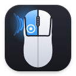
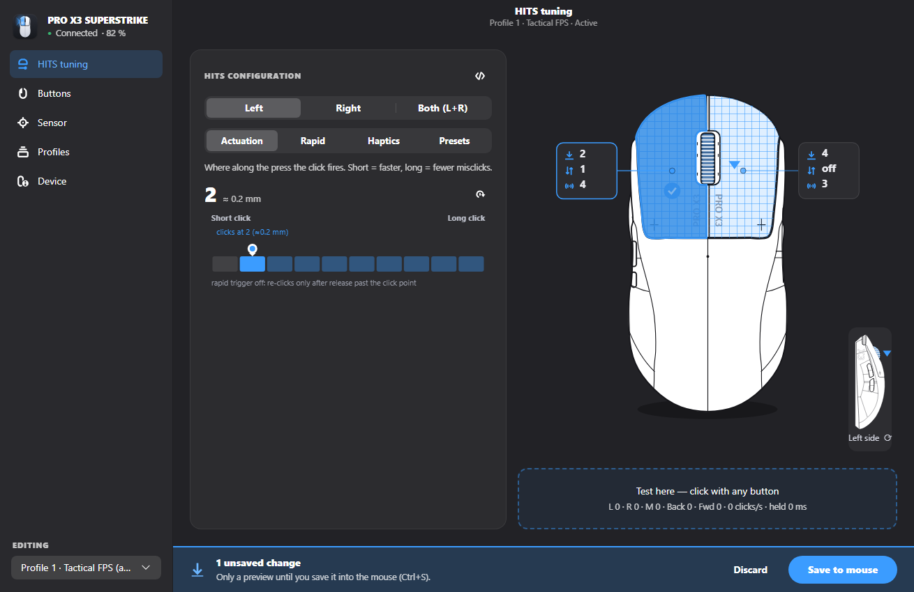
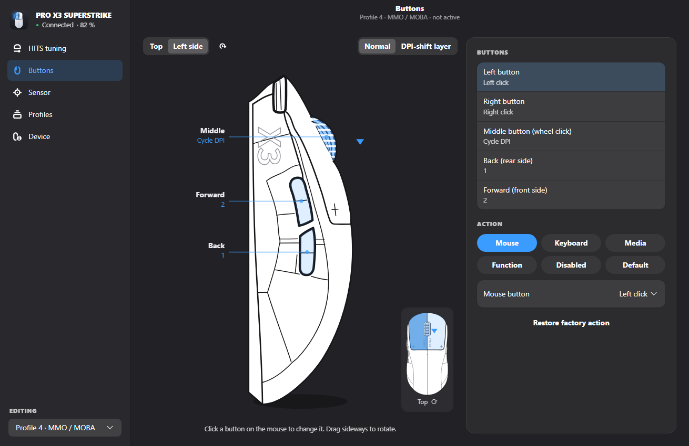
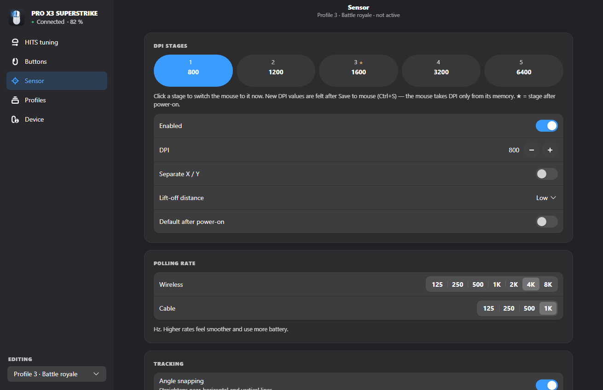
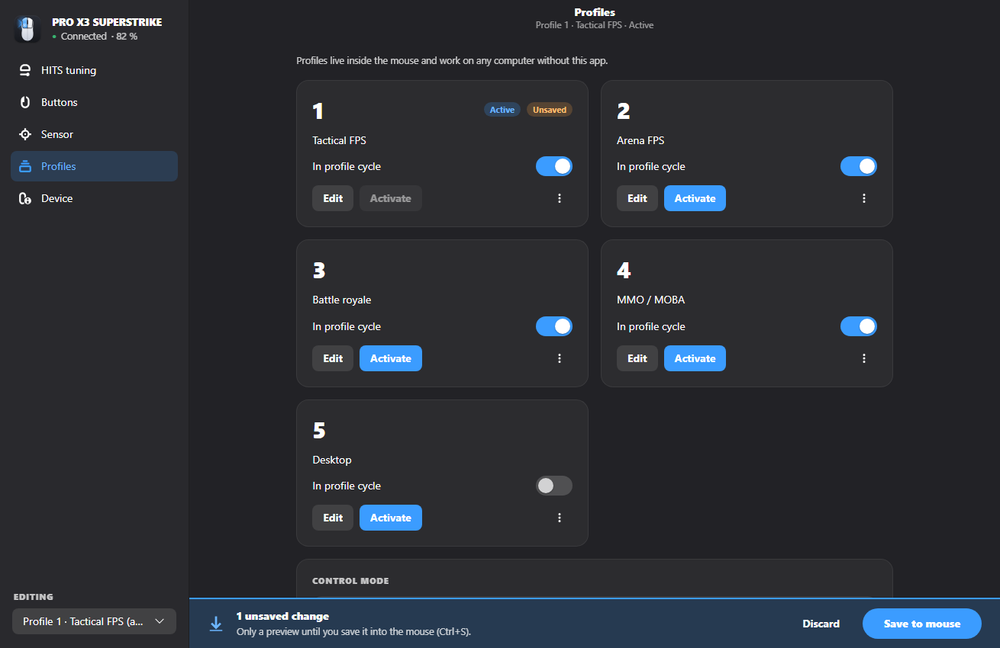
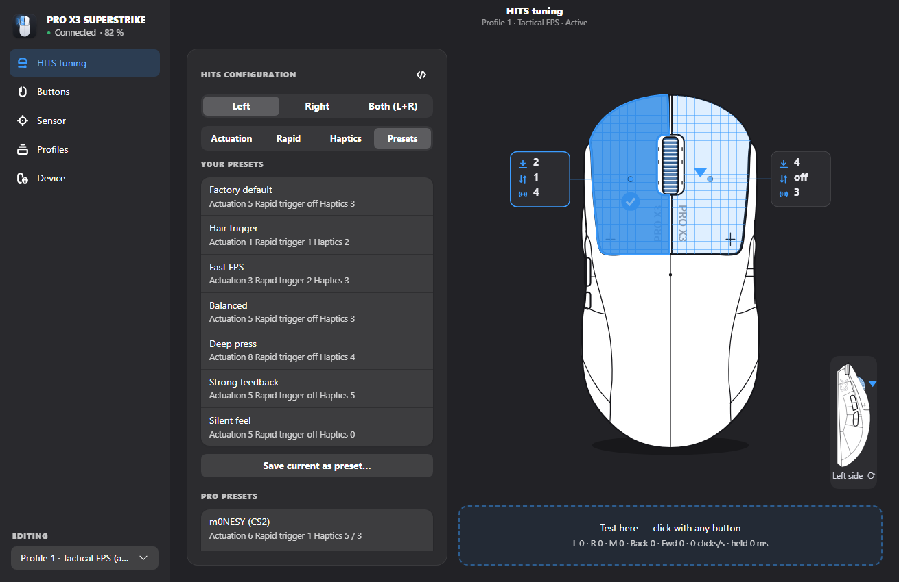

<div align="center">



# SuperStrike Studio Plus

## Your SUPERSTRIKE, dialled in. In your browser. In a minute.

The lightweight G HUB alternative for the Logitech **PRO X3** and **PRO X2 SUPERSTRIKE**.<br>
Tune the click, save it into the mouse, close the tab, play.

[](https://truecarry.github.io/superstrike-studio/)
&nbsp;
[](https://truecarry.github.io/superstrike-studio/?demo)



**0** installs &nbsp;·&nbsp; **0** background apps &nbsp;·&nbsp; **0** accounts &nbsp;·&nbsp; **12** pro presets &nbsp;·&nbsp; **21** languages &nbsp;·&nbsp; **free**

</div>

---

## Nothing between you and the game

You paid for the best click on the market. You shouldn't need a heavy launcher running all day to
keep it.

SuperStrike Studio Plus writes every setting **into the mouse itself**. Once you press
**Save to mouse**, you can close the page for good: no tray icon, no service, no updater, no
overlay, no account. Your mouse clicks the same in every game and on every PC, and no software
update can change how it feels overnight.

## Play like the pros

Pick a player, feel it on the test pad, save. Done.

| CS2 | VALORANT | League of Legends | Rainbow Six Siege |
|:--|:--|:--|:--|
| m0NESY · INS · KSCERATO | Coach Joe · McFaliN · Yetujey | ShowMaker · Siwoo · Lucid · Smash · Career | Blaz |

Got a **HITS code** from a friend, a video or G HUB? Paste it in. Want to share yours? One click
copies it — it works in G HUB too.

## Find your perfect click

The SUPERSTRIKE has no ordinary switch: magnetic sensors and a haptic motor replace it. That gives
you three dials no other mouse has.

| | What you feel | Range |
|---|---|---|
| **Actuation point** | How far you press before the shot goes out | 1 hair-trigger … 10 deep |
| **Rapid trigger** | How little you lift before you can fire again — faster taps and spam clicks | 1 fastest … 5 slowest, or off |
| **Click haptics** | How strong the click feels under your finger | 0 silent … 5 strongest |

Change a value and the mouse reacts **instantly**, before you save. The built-in test pad counts
your clicks per second and hold time, so you compare levels by feel, not by guessing.

**What the pros use** (the presets in the app, from HITS codes published by Logitech):

| You play | Actuation | Rapid trigger | Haptics | Tip |
|---|---|---|---|---|
| **CS2** | 2 to 6 | 1–3 | 3–5 | KSCERATO taps at 2, m0NESY presses deep at 6 — both win |
| **VALORANT** | 2–4 | 2–3 | 2–5 | Go one step deeper if you fire by accident when you tense up |
| **League of Legends** | 2 | 1–2 | 1–4 | Fastest reset for abilities and kiting |
| **Rainbow Six Siege** | 6 | 3 | off | Blaz: deep, deliberate clicks with no buzz |
| **Work and everyday** | 5 or deeper | slow or off | to taste | Fewer accidental clicks; put it on its own profile |

## One mouse, five setups

Keep **five profiles** in the mouse — say CS2, VALORANT, League, Desktop and a spare — and flip
between them with a mouse button. Each one carries its own click feel, button actions, DPI stages
and polling rate.

<table>
  <tr>
    <td width="50%"><br><b>Every button</b>: keys with modifiers, media keys, DPI and profile switching, a second layer while you hold DPI shift</td>
    <td width="50%"><br><b>Sensor</b>: five DPI stages up to 48 000, polling up to 8 000 Hz, lift-off distance, angle snapping</td>
  </tr>
  <tr>
    <td><br><b>Profiles</b>: name, copy, export and back up all five</td>
    <td><br><b>Presets</b>: pros, built-ins and your own, one click each</td>
  </tr>
</table>

## Up and running in a minute

1. **[Open the page](https://truecarry.github.io/superstrike-studio/)** in Chrome or Edge — Windows, macOS or Linux.
2. **Click Connect** and pick **USB Receiver**.
3. **Tune it** and press **Save to mouse**. Close the tab. Play.

Next time the page finds your mouse by itself. Using G HUB? Quit it first (also in the tray) so it
lets go of the receiver.

## Plus vs G HUB

| | **SuperStrike Studio Plus** | Logitech G HUB |
|---|:-:|:-:|
| Set up | **open a link** | download and install |
| Running while you play | **nothing** | background service unless you turn it off |
| Account | **never** | optional |
| Updates | **automatic: always the latest page** | updater in the background |
| Windows · macOS · Linux | **✅ ✅ ✅** | ✅ ✅ ❌ |
| Actuation, rapid trigger, haptics | ✅ | ✅ |
| Haptics saved in the mouse | ✅ | ❌ ¹ |
| Pro presets and HITS codes | ✅ | ✅ |
| Live click test pad | ✅ | ➖ |
| Try it without the mouse | ✅ | ❌ |
| Lighting, macros, other Logitech gear | ❌ | ✅ |
| Price | free, open source | free |

<sub>¹ In tests with a PRO X3 SUPERSTRIKE by the SuperStrike Studio authors. ➖ G HUB shows a press
meter, not a click counter. Need lighting, macros or other Logitech devices? G HUB does far more —
Plus does one mouse, and does it lightly. Spotted something wrong? [Tell us](https://github.com/TrueCarry/superstrike-studio/issues).</sub>

## Questions

**Is it safe to let a web page talk to my mouse?**
The browser only lets the page reach the device you pick in its own pop-up, and only while the tab
is open. Nothing is uploaded: presets and backups stay in your browser. The code is open for anyone
to check.

**Can it break my mouse?**
It writes the same onboard profiles G HUB does and never touches the factory profile. Every save is
read back and verified, a full backup is taken before your first save, and **Reset to factory** is
always one click away.

**Can I go back to G HUB?**
Any time. Just don't run both at once.

**Does it work in Firefox or Safari?**
Not yet — they don't let web pages talk to USB devices. Use Chrome, Edge, Brave or Opera.

**My mouse doesn't show up.**
Turn the mouse on or move it, quit G HUB, then **Connect** again and pick **USB Receiver**. On macOS,
allow Input Monitoring for the browser if asked. On Linux, run this once and replug the receiver:

```sh
echo 'KERNEL=="hidraw*", SUBSYSTEM=="hidraw", ATTRS{idVendor}=="046d", TAG+="uaccess"' | sudo tee /etc/udev/rules.d/70-superstrike.rules
sudo udevadm control --reload-rules && sudo udevadm trigger
```

**PRO X2 or PRO X3?**
Both. It was verified on a PRO X3 SUPERSTRIKE; the PRO X2 uses the same features, and reports are
welcome.

<div align="center">

[](https://truecarry.github.io/superstrike-studio/)

<sub>English · 简体中文 · 繁體中文 · 日本語 · 한국어 · Русский · Українська · Español · Português · Français · Deutsch ·
Italiano · Polski · Türkçe · العربية · हिन्दी · বাংলা · اردو · Bahasa Indonesia · Tiếng Việt · ไทย</sub>

</div>

---

<details>
<summary><b>For developers</b></summary>

Needs [Bun](https://bun.sh).

```sh
bun install
bun run dev          # http://127.0.0.1:8017 (add ?demo for the demo mouse)
bun test             # profile format, HITS codes, demo mouse, translations
bun run build        # static site in dist/, works from any folder (hash routes)
bun run screenshots  # README screenshots with the demo mouse, into docs/screenshots/
```

Every push to `main` is tested, built and published to GitHub Pages by
[.github/workflows/pages.yml](.github/workflows/pages.yml).

| Path | |
|---|---|
| `src/hid/` | HID++ 2.0 over WebHID: framing, request queue, device features, memory sectors, demo mouse |
| `src/model/` | Onboard profile format, button actions, directory, HITS codes, backups |
| `src/state/store.ts` | App state and every action that talks to the mouse |
| `src/pages/`, `src/components/` | React UI (React Router), mouse drawing, controls |
| `src/i18n/` | gettext catalogs loader: `t()`, `tc()` (context), `tn()` (plural), `f()` (printf) |
| `po/` | Translations (`.po`, one per language) and the template `superstrike-studio.pot` |
| `tools/parity/` | Screenshot and string comparison against the native app |

UI text goes through `t("English text")` (or `tc("context", …)`) and is looked up in the gettext
catalogs in `po/` by its exact English text; a string without a translation shows in English.

</details>

**Credits.** Made by TrueCarry and thekiba. Built on
[SuperStrike Studio](https://github.com/Adhamura/superstrike-studio) by the SuperStrike Studio
authors, whose protocol work, mouse drawings and translations made this possible.

**License.** MIT — see [LICENSE](LICENSE). Copyright © 2026 TrueCarry and thekiba; based on
SuperStrike Studio, copyright © 2026 The SuperStrike Studio authors.

<sub>Not affiliated with or endorsed by Logitech. Logitech, G HUB, PRO, LIGHTSPEED and SUPERSTRIKE
are trademarks of Logitech.</sub>
