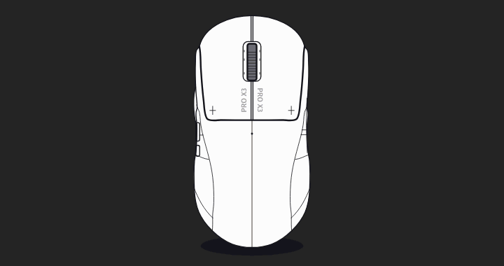
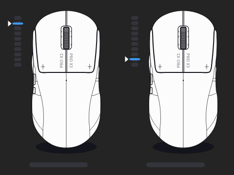
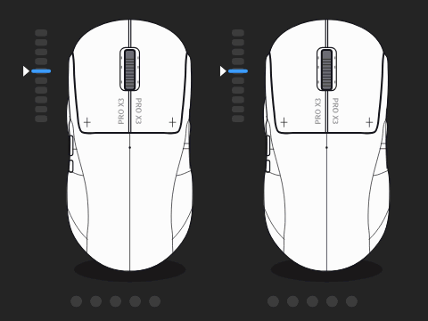
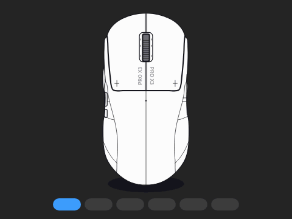
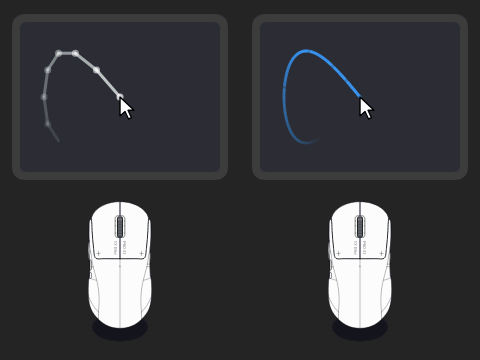
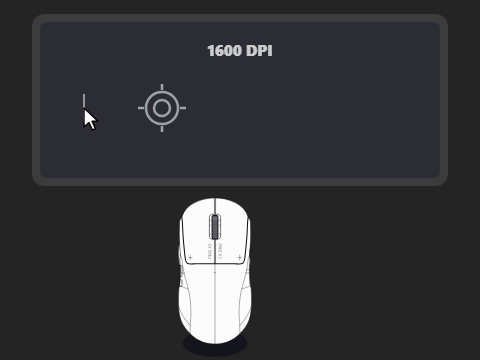
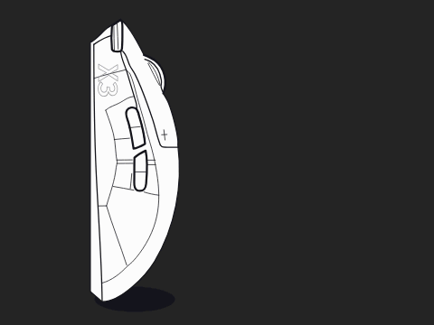
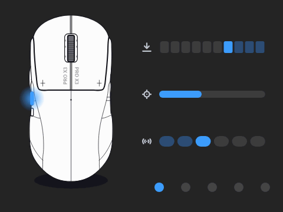
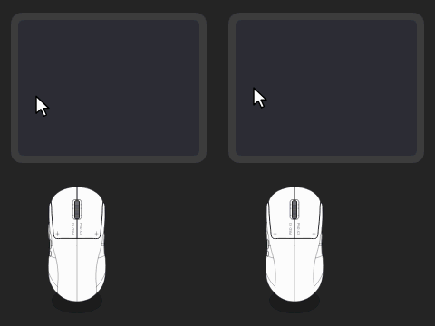
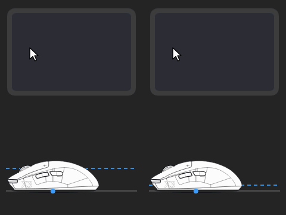

<div align="center">


# SuperStrike Studio Plus

## Set up your SUPERSTRIKE in a minute. Right in your browser.

The lightweight G HUB alternative for the Logitech **PRO X3** and **PRO X2 SUPERSTRIKE**.<br>
Tune it, save it into the mouse, close the tab. Nothing to install, nothing left running.

<a href="https://truecarry.github.io/superstrike-studio/"></a>&nbsp;<a href="https://truecarry.github.io/superstrike-studio/?demo"></a>



✓ **No install** &nbsp;&nbsp; ✓ **Nothing in the background** &nbsp;&nbsp; ✓ **No account** &nbsp;&nbsp; ✓ **Free and open source**

<sub>English · 简体中文 · 繁體中文 · 日本語 · 한국어 · Русский · Українська · Español · Português · Français · Deutsch ·
Italiano · Polski · Türkçe · العربية · हिन्दी · বাংলা · اردو · Bahasa Indonesia · Tiếng Việt · ไทย</sub>

</div>

---

## Set it once. Forget the software.

Every setting is saved **into the mouse itself**. Close the tab: no tray icon, no service, no
account, and no update can change how your mouse feels overnight.

## Make the click yours

Three dials for each main button. Feel every change live, or start from a preset or a HITS code.

<table>
  <tr>
    <td width="33%"></td>
    <td width="33%"></td>
    <td width="33%"></td>
  </tr>
  <tr>
    <td><b>Actuation point</b><br>Click on a light touch, or only on a deep press</td>
    <td><b>Rapid trigger</b><br>Click again without lifting your finger all the way</td>
    <td><b>Click haptics</b><br>From silent to a firm thump under your finger</td>
  </tr>
</table>

## The whole mouse, not just the click

Sensor, buttons and profiles, all saved in the mouse.

<table>
  <tr>
    <td width="33%"></td>
    <td width="33%"></td>
    <td width="33%"></td>
  </tr>
  <tr>
    <td><b>Polling rate</b><br>The cursor follows your hand without steps</td>
    <td><b>DPI shift</b><br>Hold a button to slow down for a precise shot</td>
    <td><b>Any button, any action</b><br>Keys, shortcuts, media, DPI or profile switching</td>
  </tr>
  <tr>
    <td></td>
    <td></td>
    <td></td>
  </tr>
  <tr>
    <td><b>Five profiles</b><br>One button switches everything at once</td>
    <td><b>Angle snapping</b><br>Straight lines from a not-quite-straight hand</td>
    <td><b>Lift-off distance</b><br>Lift the mouse and the cursor stays put</td>
  </tr>
</table>

## Up and running in a minute

1. **[Open the page](https://truecarry.github.io/superstrike-studio/)** in Chrome or Edge — Windows, macOS or Linux.
2. **Click Connect** and pick **USB Receiver**.
3. **Tune it** and press **Save to mouse**. Close the tab. Done.

Next time the page finds your mouse by itself. Using G HUB? Quit it first (also in the tray) so it
lets go of the receiver.

## Plus vs G HUB

| | **Plus** | **G HUB** |
|---|:-:|:-:|
| Actuation, rapid trigger, haptics, presets | ✅ | ✅ |
| Buttons, DPI, polling rate, profiles | ✅ | ✅ |
| Opens in the browser, no install | ✅ | ❌ |
| Closes with the tab, no background service | ✅ | ❌ |
| Windows, macOS and Linux | ✅ | ❌ |
| Try it without a mouse | ✅ | ❌ |
| Haptics saved in the mouse | ✅ | ❌ |
| Clicks-per-second test pad | ✅ | ❌ |
| Lighting, macros, other Logitech gear | ❌ | ✅ |

<sub>Need lighting or macros? G HUB is the better fit.</sub>

## Questions

**Is it safe to let a web page talk to my mouse?**
The browser only lets the page reach the device you pick in its own pop-up, and only while the tab
is open. Nothing is uploaded: presets and backups stay in your browser. The code is open for anyone
to check.

**Can it break my mouse?**
It writes the same onboard profiles G HUB does and never touches the factory profile. Every save is
read back and verified, a full backup is taken before your first save, and **Reset to factory** is
always one click away.

**Can I go back to G HUB?**
Any time. Just don't run both at once.

**Does it work in Firefox or Safari?**
Not yet — they don't let web pages talk to USB devices. Use Chrome, Edge, Brave or Opera.

**My mouse doesn't show up.**
Turn the mouse on or move it, quit G HUB, then **Connect** again and pick **USB Receiver**. On macOS,
allow Input Monitoring for the browser if asked. On Linux, run this once and replug the receiver:

```sh
echo 'KERNEL=="hidraw*", SUBSYSTEM=="hidraw", ATTRS{idVendor}=="046d", TAG+="uaccess"' | sudo tee /etc/udev/rules.d/70-superstrike.rules
sudo udevadm control --reload-rules && sudo udevadm trigger
```

**PRO X2 or PRO X3?**
Both. It was verified on a PRO X3 SUPERSTRIKE; the PRO X2 uses the same features, and reports are
welcome.

<div align="center">

<a href="https://truecarry.github.io/superstrike-studio/"></a>&nbsp;<a href="https://truecarry.github.io/superstrike-studio/?demo"></a>

</div>

---

**Developers.** Building, testing and the code layout: [CONTRIBUTING.md](CONTRIBUTING.md).

**Credits.** Made by TrueCarry and thekiba. Built on
[SuperStrike Studio](https://github.com/Adhamura/superstrike-studio) by the SuperStrike Studio
authors, whose protocol work, mouse drawings and translations made this possible.

**License.** MIT — see [LICENSE](LICENSE). Copyright © 2026 TrueCarry and thekiba; based on
SuperStrike Studio, copyright © 2026 The SuperStrike Studio authors.

<sub>Not affiliated with or endorsed by Logitech. Logitech, G HUB, PRO, LIGHTSPEED and SUPERSTRIKE
are trademarks of Logitech.</sub>
