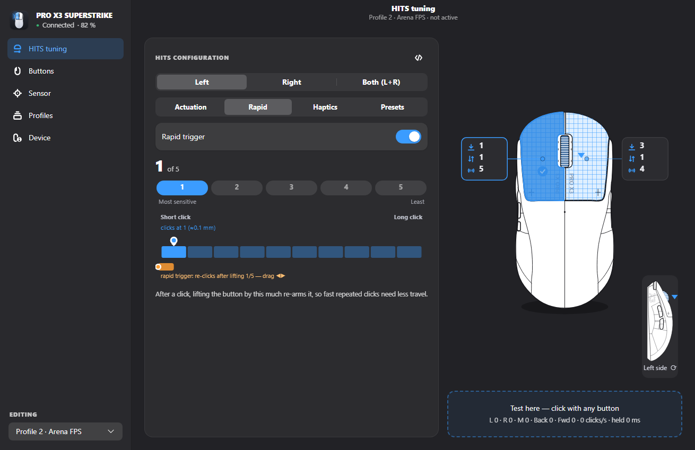
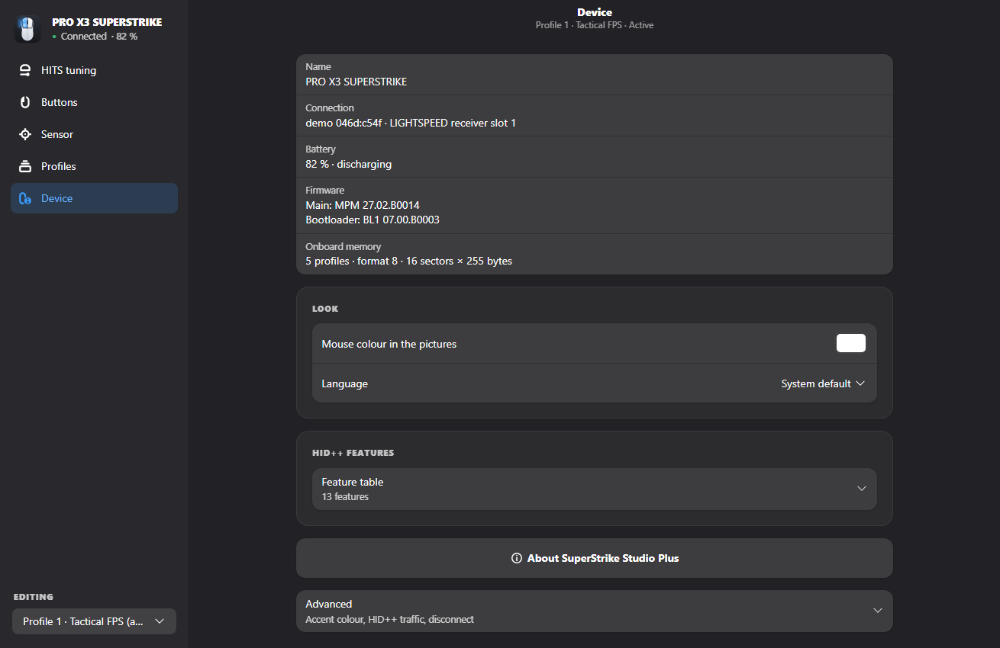
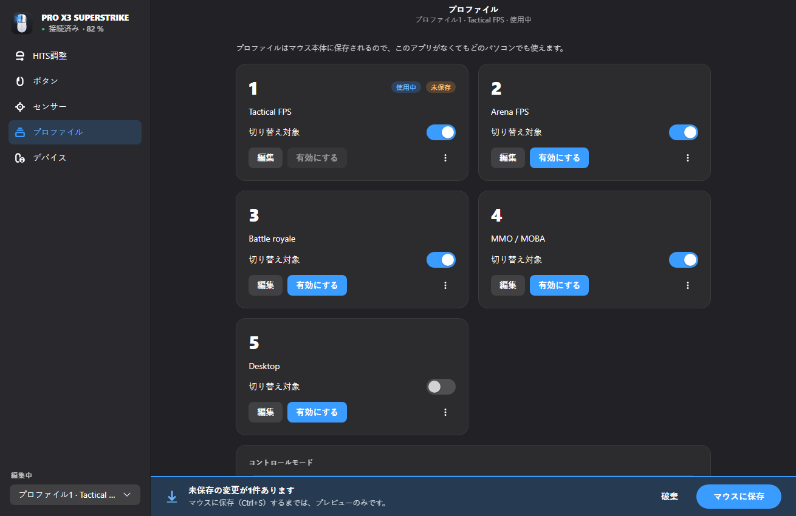
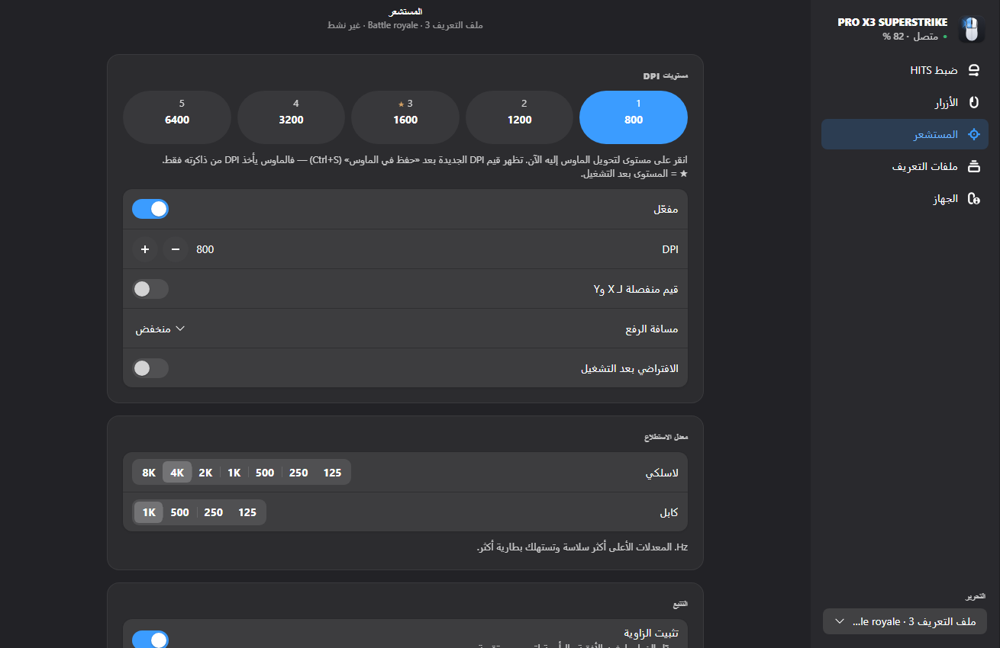

<div align="center">


# SuperStrike Studio Plus

### Set up your Logitech PRO X3 / PRO X2 SUPERSTRIKE in a minute.<br>No install. No G HUB. Nothing running while you play.

**[▶ Open SuperStrike Studio Plus](https://truecarry.github.io/superstrike-studio/)** &nbsp;·&nbsp;
**[Try the demo, no mouse needed](https://truecarry.github.io/superstrike-studio/?demo)**


Free · open source · works in Chrome and Edge on Windows, macOS and Linux · 21 languages

</div>

## Start in three steps

1. **Open the page** in Chrome or Edge: [truecarry.github.io/superstrike-studio](https://truecarry.github.io/superstrike-studio/).
2. **Click Connect** and pick **USB Receiver** (or the mouse, if it is on its cable).
3. **Tune it, then press Save to mouse.** Close the tab and play.

That's all. Your settings now live **inside the mouse**: they work in every game, on any PC, with
this page closed and no Logitech software installed. The browser remembers your mouse, so next time
it connects by itself.

> Using G HUB right now? Quit it first (also in the tray), so it does not hold on to the receiver.

## Why players switch

- **🎯 Every HITS setting, explained.** Actuation point, rapid trigger and click haptics for the left
  and right button, on a drawing of your mouse. You see what each level does before you save.
- **🏆 Pro settings in one click.** HITS presets from m0NESY, INS, KSCERATO, Coach Joe, McFaliN,
  Yetujey, ShowMaker, Siwoo, Lucid, Smash, Career and Blaz. Paste any G HUB HITS code a friend
  sends you, or copy yours to share.
- **⚡ Feel it at once.** HITS changes to the profile in use reach the mouse while you edit. The
  click test pad shows clicks per second and how long you held, so you can compare levels on the spot.
- **💾 Saved in the mouse, haptics included.** Take the mouse to a LAN, a tournament PC or a
  friend's place: plug in the receiver and it feels exactly the same.
- **🪶 Nothing in the background.** No service, no tray icon, no updater, no overlay. Nothing to
  slow your game, pop up mid-match or break after an update. Close the tab and it is gone.
- **🔒 Private.** No account, no sign-in, no telemetry. The page talks only to your mouse.
- **🧰 The whole mouse, not just the clicks.** Buttons and keys, five DPI stages, polling rate up to
  8 000 Hz, lift-off distance, angle snapping, power saving, and five onboard profiles you can
  name, copy, back up and restore.
- **🛟 Safe to experiment.** A full backup of the mouse memory is made before your first save.
  Every save is checked, and the factory settings are always one click away.

## The three HITS settings, in plain words

| Setting | What it changes | Range | Where to start |
|---|---|---|---|
| **Actuation point** | How far you press before the click counts | 1 shallow … 10 deep | **2** for CS2, VALORANT and LoL; deeper (4–6) if you fire by accident |
| **Rapid trigger** | How little you lift before the next click can count, for faster spam clicks | 1 fastest … 5 slowest, or off | **2–3** on the trigger finger; many CS2 pros turn it **off on the right button** (scope) |
| **Click haptics** | How strong the click feels | 0 off … 5 strongest | **3**, then go by feel |

Not sure? Open **HITS tuning → Presets**, pick a pro from your game, and try it on the test pad.
Starting points come from the HITS codes Logitech published with pro players.

## Screenshots

<table>
  <tr>
    <td width="50%"><br><b>Rapid trigger</b>: on/off and level 1–5, with the reset zone shown on the travel bar</td>
    <td width="50%"><br><b>Presets</b>: your own, built-in and pro-player HITS codes</td>
  </tr>
  <tr>
    <td><br><b>Buttons</b>: side view; back and forward send keys, middle cycles DPI</td>
    <td><br><b>Sensor</b>: five DPI stages, polling rate for wireless and cable, tracking and power</td>
  </tr>
  <tr>
    <td><br><b>Profiles</b>: five onboard profiles, profile cycle, activate, copy, export, backup</td>
    <td><br><b>Device</b>: connection, battery, firmware, onboard memory, language</td>
  </tr>
  <tr>
    <td><br><b>21 languages</b>: here Japanese, switched while the app runs</td>
    <td><br><b>Right to left</b>: Arabic and Urdu mirror the whole window</td>
  </tr>
</table>

<sub>Taken in Chrome with the demo mouse.</sub>

## How it compares

| | **SuperStrike Studio Plus** | Logitech G HUB | SuperStrike Studio (desktop) |
|---|:--|:--|:--|
| Install | **nothing: open a web page** | installer | one file per system |
| Runs while you play | **nothing** | background service unless you turn it off | nothing |
| Windows · macOS · Linux | **✅ ✅ ✅** in Chrome or Edge | ✅ ✅ ❌ | ✅ ✅ ✅ |
| Actuation, rapid trigger, haptics | ✅ | ✅ | ✅ |
| Haptics saved in the mouse's profiles | ✅ | ❌ ¹ | ✅ |
| Pro presets and HITS codes | ✅ | ✅ | ✅ |
| Try it without the mouse | ✅ demo | ❌ | ✅ demo |
| Updates | **always the latest, nothing to update** | background updater | in the app |
| Account, telemetry | none | optional account | none |
| Lighting, macros, other Logitech devices | ❌ | ✅ | ❌ |
| Price · source | free · open source (MIT) | free · closed | free · open source (MIT) |

<sub>✅ yes · ❌ no. ¹ In tests by the SuperStrike Studio authors with a PRO X3 SUPERSTRIKE.
G HUB is a much bigger program for the whole Logitech line-up; SuperStrike Studio Plus does one
mouse and stays out of your way. Corrections are welcome in an
[issue](https://github.com/TrueCarry/superstrike-studio/issues).</sub>

## FAQ

**Is it safe to let a web page talk to my mouse?**
The browser only lets the page reach the device you pick in its own pop-up, and only while the tab
is open. Nothing is sent anywhere else: presets and backups stay in your browser. The code is open
for anyone to read.

**Do my settings stay when I close the page?**
Yes, after **Save to mouse** (Ctrl+S). Until then, changes are a preview. The bottom bar shows how
many changes are not saved yet.

**Can it break my mouse?**
It only writes the same onboard profiles G HUB writes, never the factory profile. Every save is
read back and checked. A full backup is kept in the browser before the first save of each visit
and before every restore; **Profiles → Backup** lets you download it or put it back, and
**Reset to factory** brings back the original settings.

**Can I go back to G HUB?**
Any time. Your mouse keeps working the same way; just quit one before you open the other.

**Which browsers work?**
Chrome, Edge, Brave, Opera and other Chromium browsers on Windows, macOS and Linux. Firefox and
Safari can't talk to USB devices (no WebHID).

**Does it work with the PRO X2 SUPERSTRIKE?**
It works with any Logitech mouse that has HITS and was verified on a PRO X3 SUPERSTRIKE. The PRO X2
SUPERSTRIKE uses the same features; reports are welcome.

**My mouse doesn't show up.**
Switch the mouse on or move it, quit G HUB, then click **Connect** again and pick **USB Receiver**.
On macOS, allow Input Monitoring for the browser if it asks. On Linux, give your user access to the
receiver once, then replug it:

```sh
echo 'KERNEL=="hidraw*", SUBSYSTEM=="hidraw", ATTRS{idVendor}=="046d", TAG+="uaccess"' | sudo tee /etc/udev/rules.d/70-superstrike.rules
sudo udevadm control --reload-rules && sudo udevadm trigger
```

**A mouse straight out of the box?**
It runs on a built-in factory profile that can't be changed. Your first **Save to mouse** creates
the five onboard profiles, like G HUB does: Profile 1 with your settings, the others as factory
copies.

> Not affiliated with or endorsed by Logitech. Logitech, G HUB, PRO, LIGHTSPEED and SUPERSTRIKE are
> trademarks of Logitech.

<details>
<summary><b>For developers</b></summary>

Needs [Bun](https://bun.sh).

```sh
bun install
bun run dev          # http://127.0.0.1:8017 (add ?demo for the demo mouse)
bun test             # profile format, HITS codes, demo mouse, translations
bun run build        # static site in dist/, works from any folder (hash routes)
bun run screenshots  # README screenshots with the demo mouse, into docs/screenshots/
```

Every push to `main` is tested, built and published to GitHub Pages by
[.github/workflows/pages.yml](.github/workflows/pages.yml).

| Path | |
|---|---|
| `src/hid/` | HID++ 2.0 over WebHID: framing, request queue, device features, memory sectors, demo mouse |
| `src/model/` | Onboard profile format, button actions, directory, HITS codes, backups |
| `src/state/store.ts` | App state and every action that talks to the mouse |
| `src/pages/`, `src/components/` | React UI (React Router), mouse drawing, controls |
| `src/i18n/` | gettext catalogs loader: `t()`, `tc()` (context), `tn()` (plural), `f()` (printf) |
| `po/` | Translations (`.po`, one per language) and the template `superstrike-studio.pot` |
| `tools/parity/` | Screenshot and string comparison against the native app |

**Translations.** The catalogs in `po/` are standard gettext files. UI text goes through
`t("English text")` (or `tc("context", …)`) and is looked up by its exact English text; a string
without a translation shows in English. A few texts that only the web app has are English for now —
add them to the `.po` files to translate them.

</details>

## Credits and license

SuperStrike Studio Plus is made by TrueCarry and thekiba. It is a browser version of
[SuperStrike Studio](https://github.com/Adhamura/superstrike-studio) by the SuperStrike Studio
authors, a native app for Linux, Windows and macOS; the protocol knowledge, the mouse drawings and
the translations come from that project.

MIT — see [LICENSE](LICENSE). Copyright © 2026 TrueCarry and thekiba. Based on SuperStrike Studio,
copyright © 2026 The SuperStrike Studio authors, under the same license.
